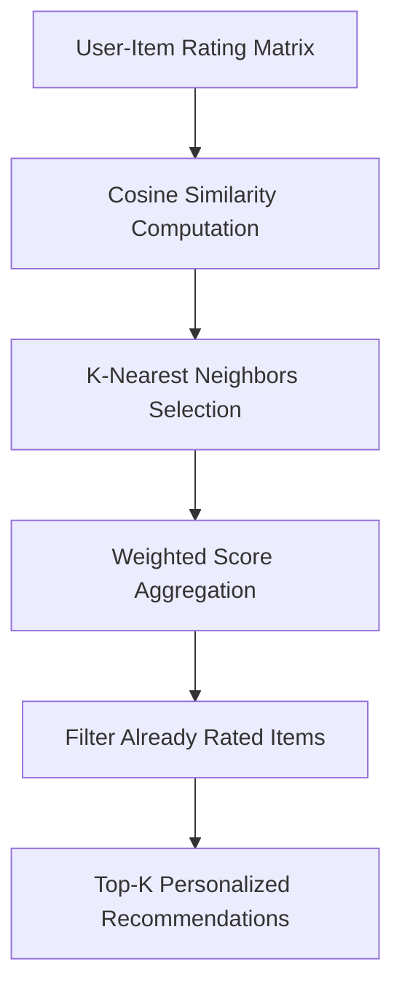

# 🎯 Collaborative Filtering Recommendation Engine

[](https://www.python.org/)
[]()
[](LICENSE)

An in-memory **User-Based and Item-Based Collaborative Filtering Recommendation Engine**. Computes cosine similarity matrices, handles cold-start users via popularity heuristics, and generates Top-K personalized recommendations.

---

## 📐 Matrix Modeling



---

## 🚀 Features

- **Item & User Cosine Similarity:** Computes normalized vector overlaps between user rating profiles.
- **Cold-Start Resilience:** Gracefully falls back to global item popularity rankings for unobserved users.
- **Top-K Ranked Recommendations:** Returns top predicted affinity items with predicted score confidence.

---

## 🛠️ Usage Example

```python
from recommender.engine import RecommenderEngine

engine = RecommenderEngine()

# Ingest historical rating events: (user_id, item_id, rating)
engine.fit([
    ("alice", "laptop", 5.0),
    ("alice", "mouse", 4.0),
    ("bob", "laptop", 5.0),
    ("bob", "keyboard", 4.5),
    ("charlie", "mouse", 4.0),
    ("charlie", "keyboard", 5.0),
])

# Recommend items for Alice
recommendations = engine.recommend("alice", top_k=2)
print("Recommended for Alice:", recommendations)
# Output: [('keyboard', 4.5)]
```

---

## 🧪 Tests

```bash
pytest tests/ -v
```

---

## 📄 License
MIT License.
